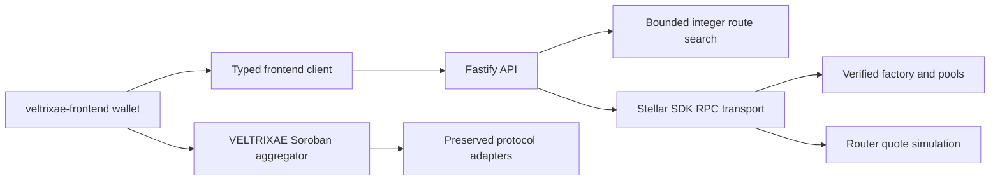

# Architecture

Contracts stay in the pinned Rust workspace. The API is a separate npm workspace with no signing key and no custodial transaction submission. Testnet network passphrase, deployed WASM hashes and router factory are checked before discovery. The VELTRIXAE aggregator manifest additionally validates its active Soroswap adapter.

Factory discovery is cached for 60 seconds; token metadata for five minutes. Reserves are freshly simulated for each quote and must share the latest ledger. Selected route estimates are checked through router simulation. Mixed-ledger observations fail rather than being combined. Queries may need retry on busy ledgers.

No database is added. Counts and market ratios are current observations. Historical analytics, USD prices and volume are null/unavailable. Add an independently checkpointed indexer and PostgreSQL only when history is required, with ledger provenance and retention policy.

Deployment configuration is operator-controlled, never provided in an HTTP request. Startup defaults bind localhost and allow no cross-origin frontend. Add the exact frontend origin explicitly. Liveness does not imply readiness.
