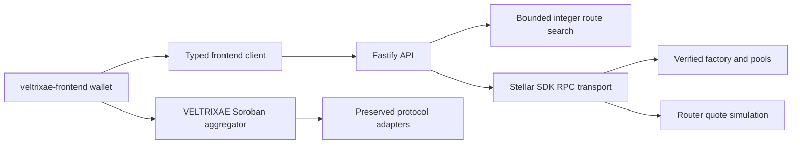
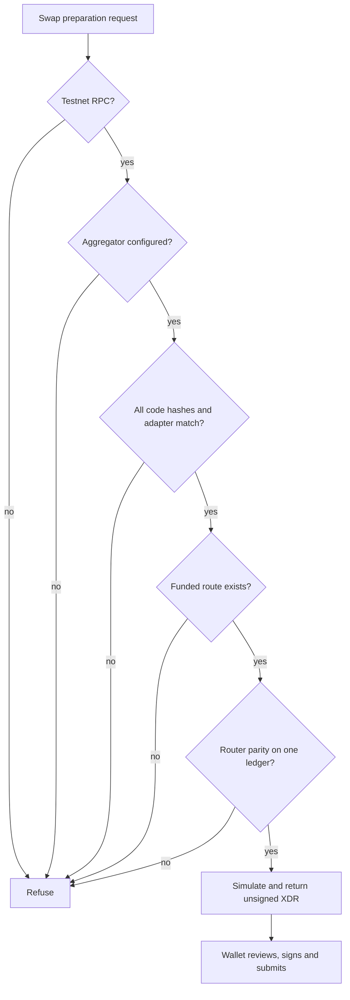

# Architecture

Contracts stay in the pinned Rust workspace. The API is a separate npm workspace with no signing key and no custodial transaction submission. Testnet network passphrase, deployed WASM hashes and router factory are checked before discovery. The VELTRIXAE aggregator manifest additionally validates its active Soroswap adapter.

Factory discovery and pool identity (tokens, factory link, registration) are cached for 60 seconds; token metadata for five minutes. Identity is immutable under the pinned pair code: it is set once by `initialize`, and the code has no setter or upgrade entry point. Code hashes are checked again for every snapshot, using one `getLedgerEntries` call that fetches every contract instance and its code bytes; the bytes are hashed locally. Concurrent snapshots share in-flight work with zero completed reserve TTL.

Reserves are the mutable state, so they carry the consistency rules. Each snapshot reads them last, beside the latest ledger: all pools must share one ledger, within one ledger of the RPC's latest. Selected route estimates are then proved by reading fresh reserves beside the router simulation. Both must share one ledger, and local integer math on those reserves must equal the router and the quote. Each stage retries at most three times within its time budget, then fails rather than combining mixed observations. Read-only checks run concurrently, because on a public RPC each sequential call can cost a ledger close. Snapshots spanning many pools may still fail on slow RPCs; see [issue draft 03](issues/03-atomic-snapshots.md).

No database is added. Counts and market ratios are current observations. Historical analytics, USD prices and volume are null/unavailable. Add an independently checkpointed indexer and PostgreSQL only when history is required, with ledger provenance and retention policy.

## Trust and execution boundaries

The API only reads chain state and prepares unsigned transactions. A wallet is the only component that signs and submits. `GET /api/v1/readiness` reports each gate as observed. The current state, and what would have to change, is in [funding evidence](FUNDING_EVIDENCE.md).

## Operation

Deployment configuration is operator-controlled, never provided in an HTTP request. Startup defaults bind localhost and allow no cross-origin frontend. Add the exact frontend origin explicitly. Liveness does not imply readiness.

Pool enumeration uses validated configurable index batches and a maximum complete factory size. A transport-wide limiter bounds nested RPC operations and queue waits across HTTP jobs. Collection deadlines prevent additional batches after timeout. No partial discovery result is used for routing. See TESTNET_SETUP.md for exact settings and ORIGINAL_CONTRIBUTIONS.md for reproducible measurements.
