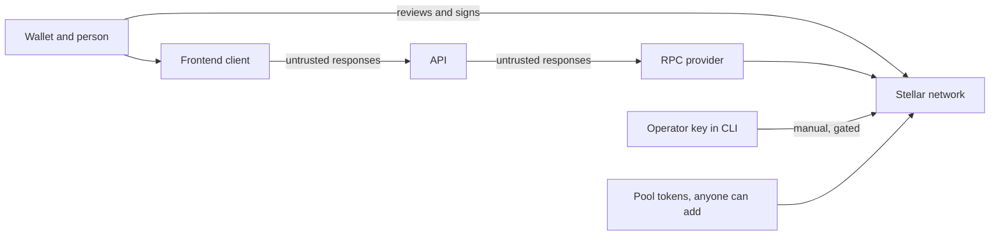

# Threat model

STRIDE-style review of the backend, client and deployed Testnet contracts, as of 2026-11-04. Written by the project and **not independently reviewed**. Testnet only: nothing protected here has real value today. Check it against SCF's current template before submitting.

## Assets and trust boundaries

| Asset | Why it matters |
| --- | --- |
| User funds and wallet authorization | A wrong transaction could spend them |
| Quote integrity | People decide from these numbers |
| Deployer key | Fee setter, and proposed aggregator admin |
| Deployment evidence | Basis of what the project claims |
| API availability | Quotes and preparation depend on it |

The API holds no keys. The wallet is the only component that should be trusted to sign.

## Threats

Status: **Mitigated** has code and tests, **Partial** leaves a gap, **Open** has no control.

| | Threat | Control | Status | Remaining gap |
| --- | --- | --- | --- | --- |
| **Spoofing** | Fake or compromised API returns a different transaction | `verifyPreparedSwap` checks unsigned XDR against the request | Partial | Integrators must call it. Authorization sub-invocations aren't inspected |
| | RPC provider lies about state | Passphrase, code hash, and router checks | Partial | All come from one provider, which could lie consistently ([issue 09](issues/09-rpc-failover.md)) |
| | Pool impersonates a real one | Code hash, factory link and `get_pair` registration checks | Mitigated | |
| | Token impersonates a known one by name | Token metadata is labelled untrusted, and IDs are used | Partial | Frontends must treat metadata as untrusted text |
| **Tampering** | Reserves change between quote and execution | Slippage limit and deadline enforced by the contract | Mitigated | |
| | Local math diverges from the router | Same-ledger parity, and fails closed | Mitigated | Must be repeated on the first VELTRIXAE pool |
| | Deployed code changes | Code hash checked on every snapshot | Mitigated | Detects change; doesn't prevent it |
| | Evidence edited after the fact | Checksums and a test, plus on-chain receipts | Partial | Someone could change a file and its checksum together. Git history and the chain still show it |
| | Malicious dependency | Lockfile, `--ignore-scripts`, Dependabot, npm audit and Rust advisory CI | Partial | No independent review of dependencies |
| **Repudiation** | Dispute over what was deployed | Seven decoded receipts on-chain | Mitigated | |
| | No record of API behaviour | Minimal request logging, with no retention | Open | Needs a decision with the [monitoring plan](MONITORING_PLAN.md) |
| **Information disclosure** | Keys leak through the API | No key input exists, and tests fail the build on signing or seeds | Mitigated | |
| | Logs leak RPC credentials | RPC URL rules, and redacted logs | Mitigated | |
| | Private vulnerability details get posted publicly | `SECURITY.md` fallback | Partial | Private reporting is disabled |
| **Denial of service** | **Pool spam: `create_pair` has no authorization, so anyone can pass `MAX_DISCOVERY_POOLS` and every quote fails with `POOL_LIMIT`** | Fails closed | **Open** | See [issue 12](issues/12-pool-spam.md) |
| | Request floods | Per-process rate limit, concurrency cap and RPC queue | Partial | Single process only. Set `TRUSTED_PROXIES` behind a proxy, and add gateway limits |
| | Slow public RPC | Time budgets and bounded retries | Partial | 3 of 20 live quotes failed closed |
| | Contract state expires | Reported as restoration required | Partial | Nothing automated; Pair code expiry is estimated for 2026-11-08 |
| **Elevation of privilege** | **Route through an unreviewed token: pools are permissionless and routing ignores the reviewed asset list, so an attacker's pool can win the best-price selection** | Final slippage limit, and a wallet review | **Open** | See [issue 11](issues/11-route-allowlist.md). The token's code runs during the swap |
| | Deployer key is compromised | Testnet only, one signer | Open | Single key. Observed: one signer, thresholds 0. Use a multisig before value |
| | Aggregator admin abuses upgrade or pause | Hash and adapter checks fail closed | Partial | No aggregator yet. Admin should be separate from the deployer |
| | Contract vulnerability | Upstream audit covers upstream scope only | Open | No independent audit of VELTRIXAE code. Deployed build lacks later `main` fixes |

## Priorities before any real value

1. An independent security review of the exact deployed hashes.
2. Route allowlist and pool spam protection ([issues 11](issues/11-route-allowlist.md) and [12](issues/12-pool-spam.md)).
3. A multisig for admin and fee setter.
4. RPC redundancy, and the monitoring plan implemented.

Mainnet stays disabled.
